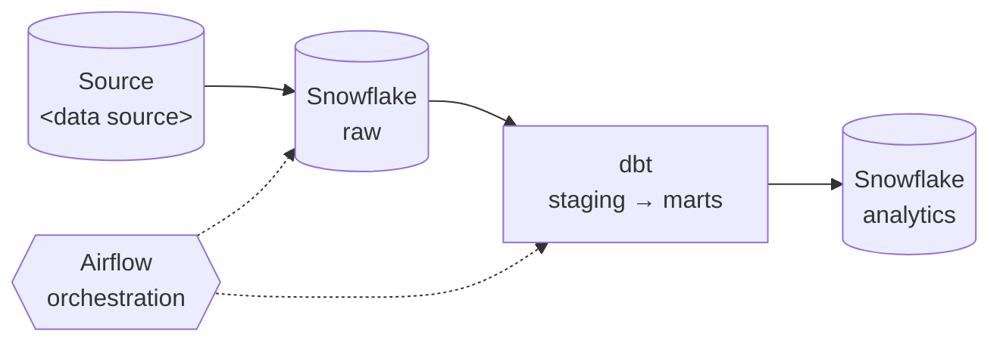

<!-- Replace every <PLACEHOLDER> before publishing. Repo name must equal your GitHub username (papwrpk). -->

<h1 align="center">Worapakorn Pongudom</h1>

  <b>Aspiring Data Engineer</b> · Bangkok, Thailand 
  Reliable data pipelines · ETL/ELT workflows · Analytics-ready datasets

  
  <a href="<LINKEDIN_URL>"></a>
  

---

## About

I build data pipelines that are reliable, tested, and easy to maintain. My background is in **Applied Statistics and Data Analysis** (B.Sc., KMITL), so I pay close attention to data quality and modeling.

---

## Tech Stack

  

| Area | Tools |
|------|-------|
| Languages | Python, SQL |
| Orchestration | Apache Airflow |
| Transformation | dbt |
| Warehouse | Snowflake, `<other: PostgreSQL / BigQuery ...>` |
| Infra | Docker, Git |
| Analytics | Statistics, Data Modeling, `<BI tool>` |

---

## Featured Projects

### [Cloud-Native ELT Pipeline with dbt & Airflow](https://github.com/papwrpk/Snowflake-ELT-Pipeline-with-dbt-and-Airflow)

ELT pipeline that loads data into **Snowflake**, transforms it with **dbt**, and is orchestrated by **Airflow** running in **Docker**.

- **Stack:** Python, Airflow, dbt, Snowflake, Docker
- **What I did:** `<e.g. customized models, added dbt tests, set up scheduling>`
- **Highlights:** `<e.g. incremental models, data quality tests, scheduled DAGs>`

### [`<Project 2>`](<REPO_URL>)

`<One or two sentences: problem, approach, outcome.>`

- **Stack:** `<tools>`

---

## Education

**B.Sc. in Applied Statistics and Data Analysis**, Faculty of Science
King Mongkut's Institute of Technology Ladkrabang (KMITL)
